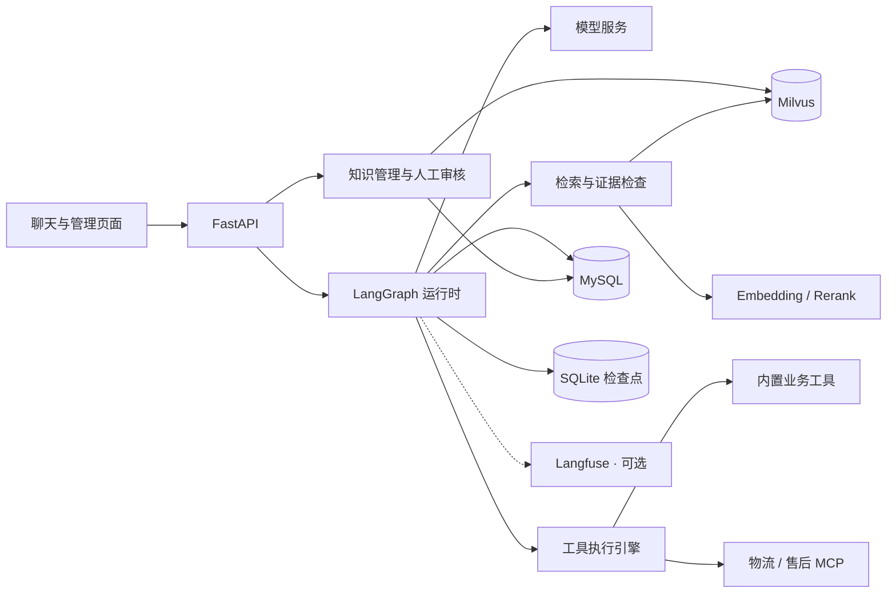

# AIcare

基于 LangGraph 与 RAG 的智能客服系统，集成流式对话、业务工具、知识库管理、人工审核和质量观测。

**版本：** `0.10.1` · **Python：** `3.12` · **部署方式：** 本机应用 + Docker 基础服务

[快速开始](#快速开始) · [项目结构](#项目结构) · [配置说明](#配置说明) · [开发文档](#开发文档)

## 目录

- [功能特性](#功能特性)
- [技术栈](#技术栈)
- [系统架构](#系统架构)
- [快速开始](#快速开始)
- [项目结构](#项目结构)
- [配置说明](#配置说明)
- [常用命令](#常用命令)
- [API 示例](#api-示例)
- [测试与评估](#测试与评估)
- [使用限制](#使用限制)
- [开发文档](#开发文档)

## 功能特性

- **智能对话**：SSE 流式输出，支持九类意图识别、指代补全、多会话管理及跨轮上下文。
- **知识检索**：结合 dense、BM25、RRF 融合和重排，提供证据检查、引用展示和低置信拒答。
- **业务工具**：内置工具自动注册，通过 MCP 接入物流与售后服务，支持参数校验、超时重试和审计。
- **用户确认**：选单、工单预览和退款表单通过明确的用户操作推进，支持持久化暂停与恢复。
- **知识运营**：材料切块、去重、会话挖掘、向量化，以及知识缺口归并和人工审核写回。
- **质量观测**：RAG 评估、置信度校准、意图 token 统计，以及可选的本地 Langfuse 调用追踪。

九类意图包括物流、订单、商品咨询、退款退货、售后、投诉、闲聊、其他和人工。

## 技术栈

| 层级 | 技术 |
| --- | --- |
| 后端 | Python 3.12、FastAPI、Pydantic |
| Agent 编排 | LangChain、LangGraph、MCP |
| 数据存储 | MySQL、SQLAlchemy Async、SQLite Checkpointer |
| 向量检索 | Milvus、dense + BM25、RRF、Rerank |
| 前端 | HTML、CSS、JavaScript |
| 观测 | Langfuse（可选） |
| 开发工具 | uv、Docker Compose、pytest、Ruff |

依赖声明见 [pyproject.toml](pyproject.toml)，锁定版本见 [uv.lock](uv.lock)。

## 系统架构



`/api/chat` 与 `/api/agent` 共用同一个 `GraphRuntime`。MySQL 保存业务数据和审计，SQLite 保存会话状态与暂停节点，模型输入按三层上下文预算单独组织。完整流程见 [架构说明](docs/project-architecture-reading.md)。

## 快速开始

### 环境要求

- Python 3.12 与 uv。
- Docker Desktop / Docker Compose，且 Docker 已启动。
- 可用的聊天、嵌入及重排服务配置。

以下命令均在项目根目录执行。

### 1. 配置环境变量

首次使用时复制配置模板：

**Windows PowerShell**

```powershell
if (-not (Test-Path .env)) { Copy-Item .env.example .env }
```

**Bash**

```bash
if [ ! -f .env ]; then cp .env.example .env; fi
```

编辑 `.env`，填写模型服务、数据库密码及连接串。字段说明见 [配置说明](#配置说明)，完整模板见 [.env.example](.env.example)。

### 2. 启动应用

**Windows PowerShell**

```powershell
.\scripts\dev.ps1
```

**Bash / Git Bash**

```bash
bash scripts/dev.sh
# 已安装 make 时，也可运行 make dev
```

启动脚本会安装锁定依赖、启动 MySQL / etcd / Milvus、应用 SQL 与种子数据、启动 MCP 服务，最后运行 FastAPI。

应用默认监听 `127.0.0.1:8000`，采用单 worker，未启用自动重载。修改 Python、提示词或 `.env` 后需重启；静态页面修改后刷新浏览器即可。

### 3. 访问页面

| 页面 | 地址 |
| --- | --- |
| 客服聊天 | [http://127.0.0.1:8000/](http://127.0.0.1:8000/) |
| 管理首页 | [http://127.0.0.1:8000/admin](http://127.0.0.1:8000/admin) |
| 知识库 | [http://127.0.0.1:8000/kb](http://127.0.0.1:8000/kb) |
| 审核队列 | [http://127.0.0.1:8000/review](http://127.0.0.1:8000/review) |
| RAG 评估 | [http://127.0.0.1:8000/rag-eval](http://127.0.0.1:8000/rag-eval) |
| 观测与成本 | [http://127.0.0.1:8000/observability](http://127.0.0.1:8000/observability) |
| API 文档 | [http://127.0.0.1:8000/docs](http://127.0.0.1:8000/docs) |

首次建库可在知识库页面预览材料、执行建库并向量化。默认材料位于 `data/kb/`，实际来源由 `KB_SOURCE_DIR` 决定。

<details>
<summary>启用本地 Langfuse（可选）</summary>

Langfuse 使用独立的 [docker-compose.langfuse.yml](docker-compose.langfuse.yml)，包含 Redis 等观测依赖，与基础 Compose 分开管理。

已有 make 时：

```bash
make langfuse-up
```

Windows 未安装 make 时：

```powershell
.\scripts\setup_make.ps1
.\.cache\bin\make.exe langfuse-up
```

该目标先补齐 `.env` 中缺失的 Langfuse 配置，再启动观测容器。启动后访问 [http://127.0.0.1:3000](http://127.0.0.1:3000)。缺少观测配置或观测故障不阻断客服。

</details>

## 项目结构

```text
.
├── app/
│   ├── api/              # HTTP API 与 SSE
│   ├── core/             # 模型、RAG、上下文、评估与观测
│   ├── db/               # ORM 与数据库仓储
│   ├── graph/            # 对话编排、状态与暂停恢复
│   ├── kb/               # 知识处理、向量写入与审核写回
│   ├── schemas/          # 请求和响应结构
│   ├── static/           # 前端页面、样式与脚本
│   ├── tools/            # 内置工具、MCP 与执行治理
│   ├── config.py         # 环境配置
│   └── main.py           # 应用入口
├── config/               # etcd 等基础服务配置
├── data/                 # 知识材料、评估产物与会话检查点
├── docs/                 # 架构、项目导航与故障排查
├── mcp_servers/          # 物流与售后 MCP 服务
├── scripts/              # 启动、初始化、知识作业与评估
├── sql/                  # 数据库迁移与种子数据
├── tests/                # 回归测试及标注样例
├── .github/              # CI、Issue 与 PR 模板
├── .editorconfig         # 编辑器约定
├── .gitattributes        # Git 换行与二进制规则
├── .env.example          # 环境变量模板
├── CONTRIBUTING.md       # 贡献与验证指南
├── SECURITY.md           # 安全报告说明
├── compose.yaml          # MySQL、Milvus、etcd
├── docker-compose.langfuse.yml
├── Makefile              # 常用任务入口
├── pyproject.toml
└── uv.lock
```

目录职责、核心调用链及脚本索引见 [项目导航](docs/README.md)。

## 配置说明

| 配置项 | 说明 |
| --- | --- |
| `CHAT_BASE_URL / CHAT_MODEL / CHAT_API_KEY` | 聊天模型地址、模型 ID 和密钥 |
| `EMBED_* / RERANK_*` | 嵌入与重排服务 |
| `MYSQL_ROOT_PASSWORD / MYSQL_PASSWORD` | Docker MySQL 初始化密码 |
| `MYSQL_PORT` | MySQL 宿主端口，模板默认 `3306` |
| `DATABASE_URL / TEST_DATABASE_URL` | 业务库和专用测试库连接串 |
| `MILVUS_URI / MILVUS_COLLECTION` | 向量服务地址与集合 |
| `KB_SOURCE_DIR` | 建库材料目录，默认 `data/kb` |
| `MCP_LOGISTICS_URL / MCP_AFTERSALES_URL` | 物流与售后 MCP 地址，默认端口 `8101 / 8102` |
| `MCP_DISCOVERY_TTL_SECONDS` | MCP 工具定义缓存时间，默认 60 秒；0 禁用 |
| `MCP_DISCOVERY_FAILURE_TTL_SECONDS` | 发现失败冷却时间，默认 5 秒；0 禁用 |
| `INTENT_MODEL / SUMMARY_*` | 可选独立意图与摘要模型 |
| `JUDGE_MODEL` | 评估裁判模型 |
| `LANGFUSE_*` | 可选本地观测配置 |

- 模型 ID 必须由所配置的上游实际支持；完整字段和默认值见 [app/config.py](app/config.py)。
- `MYSQL_PORT` 与两条连接串的宿主端口需一致；若改用 `13306`，三处一起调整。容器内部仍使用 `3306`。
- 连接串密码包含特殊字符时需 URL 编码。真实凭据只放入被 Git 忽略的 `.env`。
- 基础 Compose 使用独立 etcd，MySQL 与 Milvus 数据通过命名卷持久化。
- 迁移顺序以 [scripts/init_db.py](scripts/init_db.py) 为准，ORM 不使用 `create_all` 建表。

## 常用命令

### 知识与审核

页面后台作业和终端共用 [Makefile](Makefile) 中的固定任务。知识作业以 `scripts/kb_cli.py` 为主入口，旧脚本保留转发，支持文件调用和 `python -m`。`eval_agent.py` 共用 `eval_ch06.py` 参数解析，`make verify` 直接使用主入口。

| 命令 | 作用 |
| --- | --- |
| `make kb-preview` | 预览材料与切块 |
| `make kb-build` | 去重并写入 MySQL，状态为 pending |
| `make kb-vectorize` | 嵌入、写入 Milvus，并更新 MySQL 状态 |
| `make seed-conv` | 写入用于挖掘的演示会话 |
| `make kb-mine` | 从会话中挖掘知识 |
| `make flywheel` | 标准化问题、查重并归入审核队列 |
| `make cost-report` | 生成意图 token 报告 |

知识挖掘、向量化及飞轮可能调用付费服务。审核通过会写入知识库并向量化；候选答案不会自动发布。

> `make kb-reset` 会清空知识、暂存问答和向量，仅在明确需要重置时执行。

### 服务管理

```bash
# 查看基础容器
docker compose ps

# MCP 服务启停与检查
uv run python scripts/mcp_services.py up
uv run python scripts/mcp_services.py smoke
uv run python scripts/mcp_services.py restart --server logistics
uv run python scripts/mcp_services.py down

# 停止可选观测栈，保留数据卷
make langfuse-down
```

MCP 工具定义按服务缓存，并发发现合并；不缓存执行结果或活动连接。目录默认每 60 秒刷新，发现失败冷却 5 秒后重试。代码中可使用 `fetch_mcp_specs(refresh=True)` 强制刷新。执行校验、权限、超时、重试和审计保持原规则。

MCP smoke 不调用付费模型。`GET /health` 仅表示应用存活，不检查数据库、Milvus 或模型服务。

## API 示例

### 发起对话

`POST /api/chat` 返回 SSE；`POST /api/agent` 返回非流式 JSON。两者使用相同请求结构：

```json
{
  "user_id": "demo",
  "message": "订单 1001 的物流到哪了",
  "conversation_id": null
}
```

Bash 请求示例：

```bash
curl -N http://127.0.0.1:8000/api/chat \
  -H 'Content-Type: application/json' \
  -d '{"user_id":"demo","message":"订单 1001 的物流到哪了","conversation_id":null}'
```

新会话省略 `conversation_id` 或传 `null`；续聊带回返回的编号，并使用同一 `user_id`。流式响应包括正文、工具、引用、动作、暂停与完成事件。

### 主要接口

| 接口 | 用途 |
| --- | --- |
| `POST /api/chat` | 流式聊天 |
| `POST /api/agent` | 非流式回答、工具结果与 trace |
| `POST /api/actions/resume` | 恢复选单或工具确认 |
| `POST /api/actions/create-ticket` | 提交工单表单 |
| `POST /api/actions/create-refund` | 创建退款工单，不执行支付退款 |
| `POST /api/extract` | 结构化售后信息提取 |
| `GET /health` | 应用存活检查 |

完整参数与响应见运行中的 [API 文档](http://127.0.0.1:8000/docs)。

## 测试与评估

### 回归测试

```bash
# 先应用业务库迁移，再准备专用测试库
uv run python scripts/init_db.py --test

uv run pytest -q
uv run ruff check .
uv run ruff format --check .
```

测试采用 FakeModel / HTTP mock，不调用付费模型。数据库测试会清空专用 `aicare_test` 中的测试数据；Milvus 集成测试使用独立临时集合。

### 真实服务评估

以下任务可能消耗模型、嵌入或重排 API 额度：

```bash
make eval-retrieval
make eval-mining
uv run python scripts/eval_intent.py --smoke --resume
uv run python scripts/eval_coref.py --limit 2 --resume

# 默认每桶 1 题，共 5 题
make eval-flywheel

# 300 题 RAG 评估，按需运行
make eval-rag
```

RAG 页面读取 `data/ch04/reports/rag_eval.json`；飞轮评估与观测报告位于 `data/ch09/reports/`。历史报告、部分完成报告和小样本结果不代表当前全量验收通过。

## 使用限制

- 项目面向本机演示，尚无完整登录鉴权、限流、多副本协调及通用工单幂等机制。
- 订单、商品、物流、保修及退货进度使用演示数据；工单会真实写库，转人工为前端模拟。
- MySQL 与 Milvus 采用可恢复双写和补偿，不提供跨库原子事务；向量化中断后可重跑。
- 网页后台作业状态保存在进程内，日志落盘；服务重启后不会自动恢复作业状态。
- 问题池通过审核队列展示，尚无独立页面。旧主题分类器、训练及验收入口已撤销，历史语料保留。
- 保留 `.env`、Docker 数据卷、`data/checkpoints/` 和评估产物。`.cache/` 含 tokenizer、本地工具及评估断点，不应整体删除。

## 开发文档

| 文档 | 内容 |
| --- | --- |
| [项目导航](docs/README.md) | 目录职责、阅读顺序、脚本与报告位置 |
| [架构说明](docs/project-architecture-reading.md) | 对话生命周期、RAG、工具、上下文及数据关系 |
| [Milvus 故障排查](docs/milvus-startup-recovery.md) | etcd 健康依赖与启动恢复 |

## 参与开发

请先阅读 [贡献指南](CONTRIBUTING.md) 和 [安全说明](SECURITY.md)。统一检查入口：

```bash
uv sync --locked
uv run python scripts/check.py
```

GitHub Actions 在 Windows 和 Linux 上执行同一组静态检查、格式检查和独立回归测试；数据库、Milvus 和真实模型评估需要单独验证。运行报告和本地状态不随默认提交发布，详见 [数据目录说明](data/README.md)。

仓库尚未声明开源许可证，发布前需由项目所有者确定授权方式。
