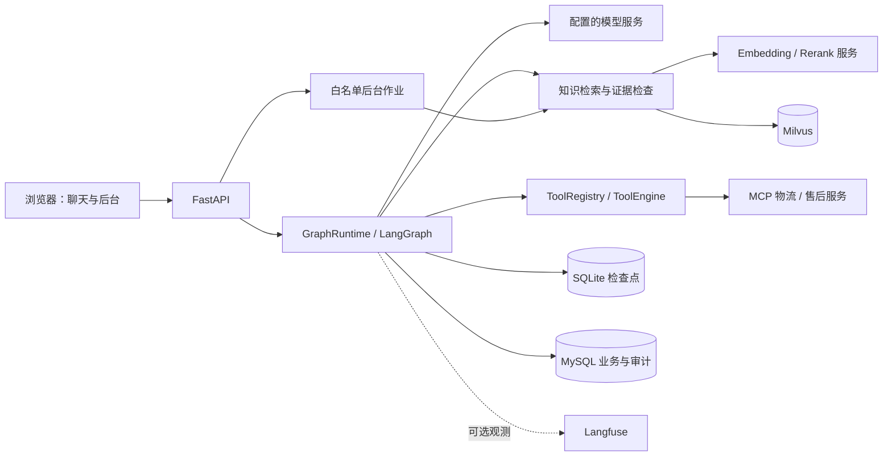
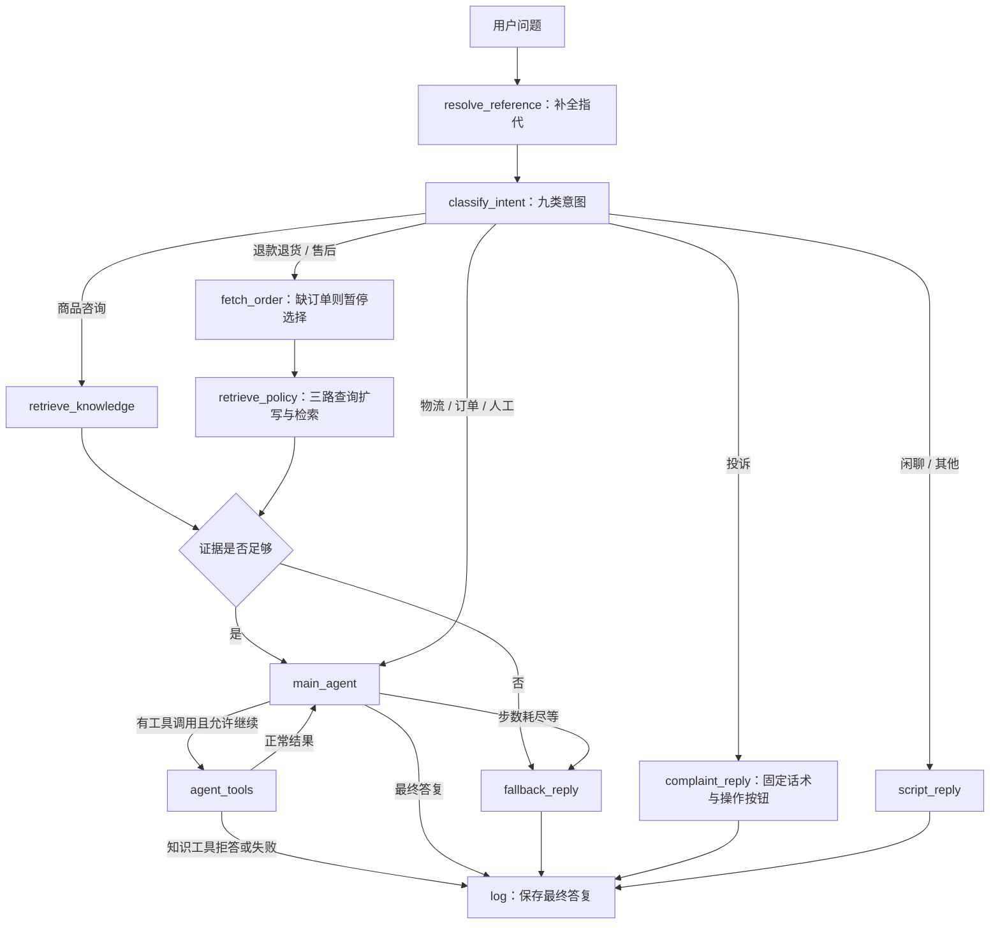

# AIcare 项目深度阅读报告

阅读日期：2026-10-14。以当前源码为依据；README 和章节笔记仅用于理解演进。本文不将历史验收结果等同于本次运行结果，也未读取或展示 `.env` 密钥。

2026-10-15 文档整理：当前启动指南见 [项目 README](../README.md)，目录与阅读入口见 [项目导航](README.md)，阶段笔记移至 [历史归档](archive/README.md)。下文测试记录仍指 10 月 14 日阅读时的验证。

## 1. 项目定位与当前范围

AIcare 是一个电商智能客服与知识运营演示系统，版本为 `0.10.1`。它把对话入口、意图分流、检索增强回答、业务工具、人工确认、长期上下文、知识补全审核和评估观测组合在一个应用里。

系统有三条互相连接的主线：

1. 在线客服：用户问题 → 补全指代 → 九类意图 → 五种处理路径 → 回答或确认卡 → 持久化。
2. 知识建设：Markdown / 历史会话 → 切块或问答挖掘 → MySQL → 向量化 → Milvus → 在线检索。
3. 质量改进：低置信 / 自检失败 / 用户差评 → 问题池 → 批量标准化与去重 → 人工审核 → 知识写回 → 再评估。

目前不是完整的真实电商业务平台：订单、商品、物流、保修和退货进度使用演示数据；工单会真实写入数据库；退款接口创建退款工单，不执行资金退款；转人工按钮只生成前端模拟问候，没有接入坐席系统。

Ch10 后台主题标签、训练与推理入口已经撤销。九类聊天意图识别仍有效，且由大模型执行。`data/ch10/`、缓存字节码和旧笔记不能视为仍在运行的分类器。

## 2. 目录职责与阅读入口

本次清点：`app/` 有 77 个 Python 源文件，`tests/` 有 47 个 `test_*.py` 文件，`scripts/` 有 36 个 Python 源文件；不把 `__pycache__` 当作源码。

| 路径 | 主要职责 | 建议优先阅读 |
|---|---|---|
| `app/main.py` | 创建 FastAPI 应用，装配数据库、模型、知识服务、运行时和路由 | `create_app()`、`agent_factory()` |
| `app/config.py` | 环境配置、模型/检索/工具/上下文参数 | `Settings` |
| `app/api/` | HTTP 契约、SSE 封装、参数验证和错误映射 | `chat.py`、`agent.py`、`actions.py` |
| `app/graph/` | 当前在线客服编排核心 | `build.py` → `routing.py` → `runtime.py` → `nodes.py` |
| `app/core/` | 模型适配、提示词、检索策略、预算、记忆、评估和观测 | `prompts.py`、`rag.py`、`memory.py` |
| `app/tools/` | 工具注册、发现、执行治理及演示业务 | `registry.py`、`engine.py`、`builtin/` |
| `app/kb/` | 知识材料、切块、入库、挖掘、向量写入及审核写回 | `service.py`、`dualwrite.py`、`review_writeback.py` |
| `app/db/` | ORM 和数据库操作 | `models.py`、`repository.py` |
| `app/schemas/` | 聊天、工具结果、恢复操作和工单输入输出结构 | `agent.py`、`actions.py` |
| `app/static/` | 原生 HTML/CSS/JavaScript 页面，无独立前端构建工程 | `index.html` 及各后台页面脚本 |
| `mcp_servers/` | 物流和售后两个独立演示工具服务 | `logistics_server.py`、`aftersales_server.py` |
| `scripts/`、`Makefile` | 启动、初始化、知识作业、评估和冒烟检查 | `dev.ps1`、`kb_cli.py`、`flywheel_pipeline.py` |
| `sql/` | 分章节的建表和迁移 SQL | Ch02–Ch09 SQL，结合 `scripts/init_db.py` 阅读 |
| `data/` | 知识材料、章节评估产物、SQLite 检查点及历史语料 | 区分输入数据、报告和归档 |
| `docs/` | 设计、实现、验证与撤销记录 | 笔记开头的最新状态优先于旧正文 |

## 3. 应用装配与部署关系

`main.py` 使用工厂与依赖注入组织应用，测试可以替换模型、数据库、分类器、指代消解器和查询扩写器。服务启动时构造 `GraphRuntime` 并扫描内置工具；SQLite 图检查点在 `ensure()` 中按需初始化。

主要依赖为 Python 3.12、FastAPI、LangChain、LangGraph、SQLAlchemy async + asyncmy、Milvus 和 MCP。浏览器静态页面与 API 由同一个 FastAPI 进程提供。

`scripts/dev.ps1` 执行锁定依赖安装、Docker 基础服务启动、数据库初始化、MCP 服务启动，然后运行本机 `127.0.0.1:8000`。当前设计是单 worker；代码修改需重启后端。

`compose.yaml` 的实际基础服务是 MySQL、Milvus 和独立 etcd；Milvus 等 etcd 健康后启动，并复用原数据卷。Langfuse 使用另一份 compose，属于可选观测系统。

## 4. 一次聊天的完整生命周期

两个聊天入口共用同一个运行时和同一张图：

- `POST /api/chat`：把图事件转换成 SSE，供聊天页使用。
- `POST /api/agent`：用 `ainvoke()` 返回最终结构化结果，适合脚本调用和测试。

`GraphRuntime.turn()` 先检查当前输入预算，再创建或取得会话；续聊验证 `user_id` 与会话记录一致。同会话在进程内串行，不同会话可以并发。

如果上一轮停在确认卡，新问题会放弃旧暂停路径，避免重新执行待确认写操作。当前用户原话先写入 MySQL；有 SQLite 状态时沿用检查点，没有检查点时由 MySQL 重建消息和工具配对。每轮证据、动作、步数和工具结果等临时字段重新初始化。

图的实际分支如下：

关键细节：

- `confidence_check` 节点本身只记 trace；真正的证据判定已经在检索节点中调用 `rag.assess()` 完成。不要仅凭节点名称定位算法。
- 默认最多 6 次主 Agent 推理，不是整个请求最多 6 次模型调用；指代消解、分类、扩写、自检和后台摘要还可能调用模型。
- 业务路径允许 Agent 自主选择工具；知识路径强制先检索；售后路径强制先查订单与政策。
- 物流查询需要先从订单工具获得 `tracking_no`，再调用物流工具。
- 工具选择消息、工具结果和最终答复分阶段提交，保留失败前已经完成的审计；没有把整轮包装成一个数据库事务。
- SSE 包含正文 `delta`、`tool`、`citations`、`actions`、`interrupt`、`done`；只把主 Agent 文本作为模型正文输出。中断表示等用户操作，不等于正常完成。

## 5. RAG：知识如何变成回答依据

### 5.1 建库

`sources.materials()` 从配置的 `KB_SOURCE_DIR` 读取 Markdown。项目自带 `data/kb/` 有商品 FAQ、售后手册、商店政策三份演示资料；实际运行可配置外部目录，因此不能把仓库材料数当作当前线上知识数。

`documents.build_chunks()` 按一至六级标题划分，保存分类和章节路径，识别标题中的 `[关键]`；默认 700 字符块、100 字符重叠。长段落尽量按完整句子重叠；表格拆分保留表头。知识块还保存前后块 ID，但当前检索没有基于这些 ID 自动补全邻块。

入库按规范化问法与正文指纹去重，先写 MySQL `pending`。`vectorize_pending()` 默认每批 16 条，将分类、问法、答案拼接后嵌入；Milvus upsert 使用 MySQL ID，成功后才把 MySQL 标为 `done`。

因此，向量已写入但状态未更新时可以重跑，不会新增另一个主键。这是可恢复双写，不是跨 MySQL/Milvus 的原子事务。总览的一致性判断主要是 done 数量、向量数量和 pending 数，并非逐条内容校验。

### 5.2 在线检索与拒答

当前默认 `hybrid_rerank`：原查询生成 dense 向量；可选模型改写只扩展 BM25 检索文本；dense 与 BM25 各召回 50，经 RRF 融合，再交重排服务。图的知识路径显式取 10 条，而非单纯由 `RETRIEVAL_TOP_K` 决定。

Milvus schema 固定 dense 维度 1024，包含中文 analyzer、BM25 sparse 字段和元数据。替换嵌入模型时需要核对维度与集合兼容性。

普通知识问答先计算四信号分数：

`0.75 × top1 + 0.10 × min(有效候选数 / 3, 1) + 0.10 × top1/top2 分差 + 0.05 × 关键条款命中`

这里“有效候选”指相关性分数至少 0.5。配置默认阈值是 `0.100168`，不是概率校准后的正确率。过数值闸后仍需模型语义自检。退款政策路径保留独立的最高重排分阈值与政策自检，不能把两者说成完全相同的置信算法。

证据不足会先拒答，再把原问题及检索快照记录到问题池；通过后给证据编号，要求回答事实句使用引用。引用排序把最高分放首位、次高分放末位。代码主要通过提示词约束引用，离线评估检查回答质量，不能宣称线上每个事实均经过严格自动校验。

## 6. 工具执行与用户确认

`ToolRegistry` 扫描 `app.tools.builtin` 中的 `register()`。2026-10-16 更新：模型绑定与执行共用按服务的 MCP 定义缓存，成功默认保留 60 秒，失败冷却 5 秒；并发发现合并，过期或显式刷新后更新。缓存不包含业务结果，执行仍通过现有引擎治理。同名冲突保留已有注册，服务不可用时跳过对应发现。

Agent 工具执行经过 `ToolEngine`：发现 → JSON Schema 校验 → 本地权限判断 → 系统参数注入 → 超时/重试 → 结果体积检查 → 审计。只读工具仅对暂时网络或超时故障重试；`create_ticket` 不自动重试；审计失败记录日志但不阻断工具结果。

三种操作必须区分：

| 操作 | 真正发生的行为 |
|---|---|
| Agent 调用 `create_ticket` | 在图中先 `interrupt` 展示预览，确认后恢复并写工单；取消则拒绝执行 |
| Agent 调用 `submit_refund` | 只提议退款表单，随后用户提交 `/api/actions/create-refund` 才建退款工单 |
| 用户点击投诉等“建工单”按钮 | 前端表单调用 `/api/actions/create-ticket`，直接调用内置工具写库 |

确认节点恢复时会从节点开头重跑，因此 `agent_tools()` 把中断前部分保持为无执行、无审计写入的纯前缀。恢复校验暂停类型、候选订单、确认值和可选的 `interrupt_id`，阻止过期卡片操作。

`conversation_id` 对模型隐藏并由系统注入。权限策略当前用工具名集合 `WRITE_TOOLS={create_ticket}`，适配本项目受控只读 MCP 服务；新增远程写工具时必须同步补充权限策略。

注意：“所有写入均走统一工具引擎”并不成立。表单直建工单和退款提交有自己的路径，未统一经过 `ToolEngine` 的审计入口。退款有当前图状态内的重复提交检查，但不是通用、持久化的跨故障幂等协议。

## 7. 三种状态与三层上下文

| 状态载体 | 保存什么 | 用途 |
|---|---|---|
| MySQL | 原始消息、业务工单、摘要段、知识、审核和审计 | 业务持久化及检查点缺失后的历史恢复 |
| SQLite checkpointer | LangGraph 会话状态、暂停节点和恢复信息 | 继续执行同一流程 |
| 模型输入副本 | 按预算组织的历史、摘要、当前问题、证据和本轮工具消息 | 控制 token 与协议完整性 |

三层上下文的行为是：近轮保留原文；中间轮压缩 assistant 文本及大工具结果；远轮在中间层超预算后异步生成摘要段。完整 State 和 MySQL 原文不因模型输入裁剪而删除。

`budget.compute()` 从模型窗口扣除系统、证据、摘要、输出和安全余量，再预留本轮工具循环峰值，分配历史窗口；默认历史窗口中 70% 为近轮预算。`model_messages()` 会再次检查实际构造的输入。

`memory.py` 按用户消息锚点分层，保留工具调用/返回配对；未完成历史在输入副本中补工具失败结果，避免协议错误。`Summarizer` 在后台按会话调度，追加摘要段，默认注入最近 3 段；旧段不反复压缩。摘要失败不影响已返回的回答，后续轮次可再次触发。

## 8. 知识飞轮、评估与观测

问题池三种来源是 `retrieval_low_conf`、`self_check`、`user_feedback`。点赞目前写日志，点踩写问题池；并非完整的逐消息满意度分析系统。

`Flywheel.process_pending()` 在锁内顺序处理未归并问题，读取最多 200 个候选，由模型给出标准问法、候选 ID 和建议答案，再由仓储校验并新建或归并审核项。逐项失败保留原话；配置、鉴权或余额等特定错误会停止继续调用。它由脚本/页面作业显式触发，没有常驻定时调度器。

`ReviewWriteback.approve()` 锁定待审项，将人工答案写入知识、向量化并更新审核状态。失败时回滚 MySQL，尝试删除新增向量；补偿失败明确报告待核实。它有补偿机制，但仍不是分布式事务。

另有较早的 `kb/mining.py`：从历史会话提取问答到 staging，再按问法去重自动晋升为 pending 知识，随后独立向量化。该路线与 Ch09 人工审核写回不同，不应把所有知识入库都描述成人审后发布。

评估覆盖向量、BM25、混合、混合重排四策略，统计 Recall@5、MRR、证据覆盖、回答覆盖、忠实性和拒答等；区分完成分母与预期分母，失败请求不假装完成。RAG 页面读报告文件，忠实性问题及处置记录在 `faith_cases`，趋势在 `eval_runs`。

Langfuse 配置齐全才启用，用于图级 trace、意图标签和 token 统计，观测故障尽量不阻断客服。`costs.py` 的主要账目是 token 使用量和占比，不是货币账单。`UsageSafeChatOpenAI` 把流式上游重复提供的累计 usage 留到结尾只计一次，避免重复计数。

## 9. 数据表的业务关系

| 表 | 角色 |
|---|---|
| `conversations` | 用户会话、状态和上下文边界 |
| `messages` | user / assistant / tool 原始消息与调用关系 |
| `conversation_summaries` | 按会话顺序追加的摘要段 |
| `tickets` | 售后、投诉、咨询、其他、退款工单 |
| `tool_audit_logs` | 工具参数、状态、重试、时长和结果摘要 |
| `knowledge_chunks` | MySQL 权威知识块、邻块关系和向量化状态 |
| `qa_extraction_staging` | 历史问答挖掘暂存与晋升状态 |
| `low_confidence_questions` | 原始问题及其对应审核项 |
| `review_queue` | 标准化知识缺口、出现次数、人工审核结果 |
| `faith_cases` | 评估中的不忠实回答及处置 |
| `eval_runs` | 评估趋势 |
| `faq` | 较早章节的关键词 FAQ 表，仍保留兼容用途 |

`Repository` 通过继承 `ReviewRepository` 暴露会话与审核操作；知识使用独立 `KnowledgeRepository`。这是一种偏轻量的仓储组织，并没有严格拆成完全独立的业务领域服务。

## 10. 前端与接口内容

当前保留六个页面：聊天 `/`、管理 `/admin`、知识 `/kb`、审核 `/review`、观测 `/observability`、RAG 评估 `/rag-eval`。

聊天页大部分逻辑写在 `index.html` 的内联脚本中，负责会话选择、localStorage 缓存、服务器历史回载、Markdown 渲染、证据弹窗、反馈、确认卡及表单。流式接口用 `fetch` 读取并解析 SSE，设置请求超时，分别处理正常完成、暂停和错误。

后台作业通过 `Jobs` 运行固定 Make 目标，而非任意命令。作业状态在内存，日志落盘；服务重启后不恢复任务状态。`/health` 仅返回应用存活，不验证数据库、Milvus、MCP 或模型可用性。

## 11. 已识别的边界与阅读陷阱

1. **历史文档有版本混杂。** 10 月 14 日检查时 README 旧段落包含“未实现 MCP”“审核为占位”“反馈不写库”“嵌入式 etcd”等过时说法；10 月 15 日已重写现行 README，旧版移入归档。历史笔记仍需结合 `main.py` 的路由、实际函数调用和 compose 阅读。
2. **历史实现并存。** `core/agent.py` 的 `AgentService`、`tools/infra.py`、`SessionMemory` 和 `CHAT_PROMPT` 是早期路径；当前客服入口采用 `GraphRuntime`。
3. **提示词会覆盖与拼接。** `prompts.py` 先定义早期 `AGENT_SYSTEM`，再生成 `GRAPH_AGENT_SYSTEM`，最后重新赋值 `AGENT_SYSTEM`。只读文件开头会误判当前系统仍限制一轮工具。
4. **身份校验尚不完整。** 续聊检查 user_id，但没有登录认证；按 cid 读取历史、恢复或建工单等接口并非完整用户权限体系。当前适合本机演示，不宜直接作为多用户服务暴露。
5. **单进程状态较多。** 会话锁、作业状态、查询改写缓存等在内存；SQLite 与 MySQL 也没有整轮原子提交。多 worker / 多副本需要额外设计。
6. **置信度不等于回答准确率。** 四信号阈值和默认模型窗口是本项目配置/算法假设，效果须绑定当前知识与真实评估集验证。
7. **审计口径有差异。** 图 trace 的 `tokens_used` 累加主 Agent 使用量，不代表指代、分类、自检等所有模型调用成本；全链路看观测数据。
8. **确认不等于全局幂等。** 工单写入与图状态推进存在边界，提交结果不确定时不能直接重试；源码也给出相应提示。
9. **历史材料不等于当前运行状态。** 本次没有查询业务数据库或启动服务，无法确认当前知识条数、容器健康或模型配置是否仍与旧笔记一致。

## 12. 本次验证与后续阅读顺序

本次运行了以下 7 组无需真实数据库或付费模型的测试：路由、售后逻辑、四信号置信度、检索分支、上下文分层、工具结果预算、已撤销入口。结果：**35 passed**。最初沙箱内 Python 启动受限，经允许的提权执行完成验证。

未运行全量数据库/Milvus 集成测试，未启动付费评估，未修改应用源码。测试 fixture 中存在清理专用 `aicare_test` 数据的行为，因此不能把全量测试视为纯只读检查。本次新增产物仅此报告（测试可能更新本地缓存/日志）。

建议按以下顺序继续阅读：

1. `main.py`：搞清对象怎样装配，以及两个聊天接口共享哪个实例。
2. `graph/build.py`、`routing.py`：先建立路径全貌。
3. `graph/runtime.py`：理解会话生命周期、检查点、SSE 与恢复。
4. `graph/nodes.py`：把每条路径的输入、输出、副作用串起来。
5. `core/rag.py`、`retrieval.py`、`kb/milvus_client.py`：追踪证据生成与拒答。
6. `tools/engine.py` 与 `api/actions.py`：对比 Agent 工具执行与直接表单操作。
7. `core/memory.py`、`summarizer.py`、`budget.py`：理解长期对话预算。
8. `core/flywheel.py`、`kb/review_writeback.py`、评估脚本：理解离线知识改进闭环。

当前架构最值得掌握的是：用确定性流程约束 Agent 的自由度、把业务持久化和模型上下文分开、用证据闸控制知识回答、把在线失败转化为可审核的知识改进输入。
